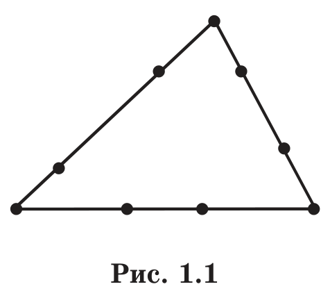

На сторонах трикутника відмічено дев'ять точок (рис. 1.1). Ми хочемо вибрати три із цих дев'яти точок, які не лежать на одній прямій. Можна, наприклад, вибрати три вершини трикутника або ліву вершину та дві додаткові точки на протилежній стороні тощо. Скільки всього існує можливих варіантів вибору таких трьох точок, включаючи два наведених приклади?

