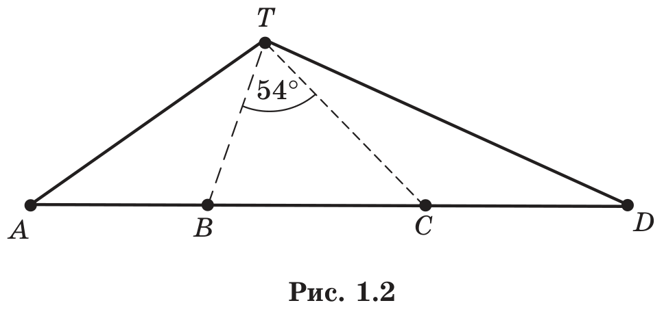

Точки $A$, $B$, $C$, $D$ лежать на прямій у вказаному порядку. Поза цією прямою існує така точка $T$, для якої $AB = BT$ та $CD = CT$. Крім того, $\angle BTC = 54^\circ$ (рис. 1.2). Знайдіть градусну міру кута $ATD$.

