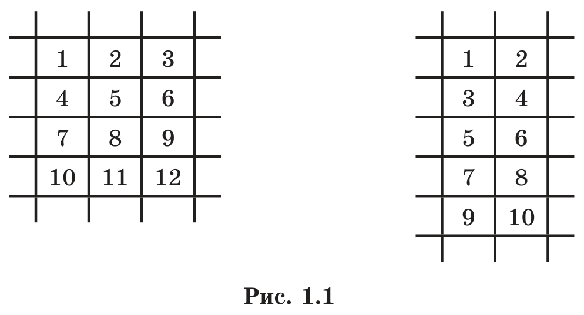

Якщо нарисувати $5$ горизонтальних і $4$ вертикальні прямі, то можна отримати таблицю з $12$ клітинок, а якщо нарисувати $6$ горизонтальних і $3$ вертикальні прямі, - то таблицю з $10$ клітинок (рис. 1.1). Яка максимальна кількість клітинок може утворитися в таблиці, якщо схожим чином нарисувати $15$ прямих ліній?

