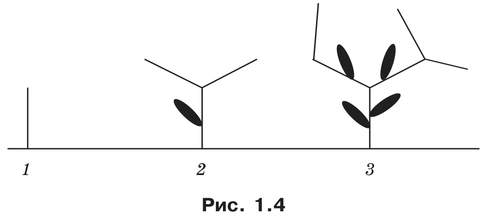

Дерево щодня приростає гілками та листочками в такий спосіб. Першого дня виростає нова гілка. Другого дня на кінці цієї гілки виростає $2$ нові гілки, а на самій гілці - один листочок. Кожного наступного дня на кінці кожної гілки, що з'явилася напередодні, виростають по $2$ нові гілки, а також по одному додатковому листочку на кожній гілці, що існувала до цього дня (рис. 1.4). Скільки листочків буде на дереві по завершенні $10$-го дня?

