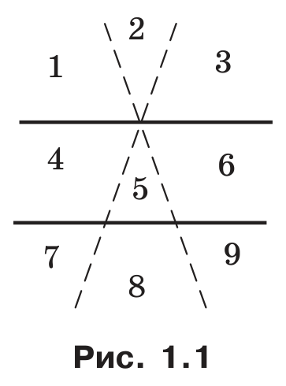

На площині проведено $5$ горизонтальних та $5$ негоризонтальних прямих. На яку найбільшу кількість частин можна поділити площину такими прямими? На рис. 1.1 наведено приклад із $2$ горизонтальних і $2$ негоризонтальних прямих, що поділяють площину на $9$ частин.

