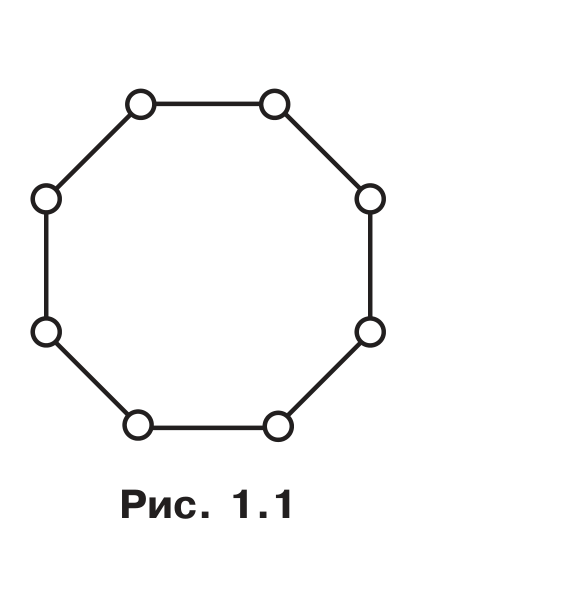

У Петрика та Даринки на двох є $8$ фішок - по $2$ червоні, чорні, блакитні та жовті. Вони їх по черзі викладають у вершини восьмикутника (рис. 1.1). Починає Петрик. Своїм ходом кожен може взяти будь-яку ще не викладену фішку і покласти в ще не зайняту вершину. Чи зможе Даринка домогтися того, щоб серед кожних чотирьох фішок, розташованих поспіль, обов'язково було по одній фішці кожного кольору?

