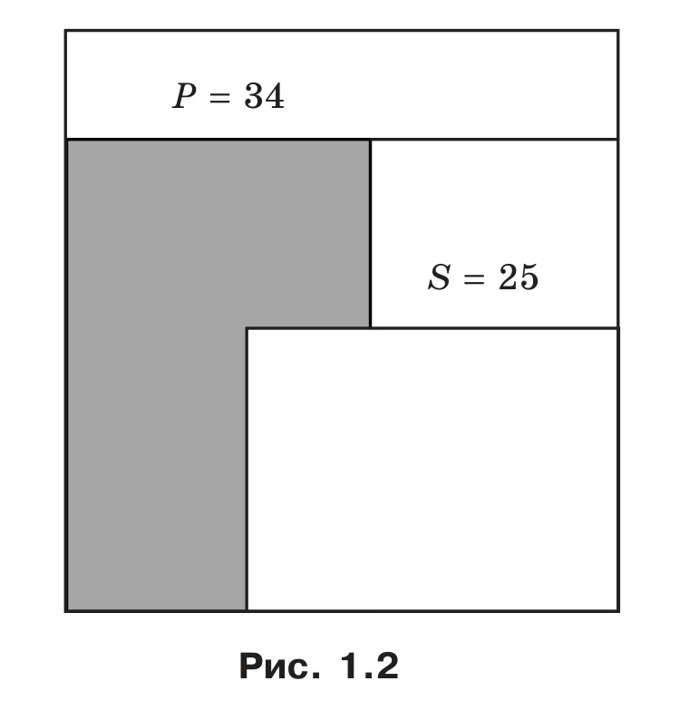

Квадрат із площею $196\,\text{см}^2$ розрізано на три прямокутники, які можуть бути й квадратами, та ще один сірий многокутник таким чином, що у кожної фігури всі сторони - натуральні числа. В одного з прямокутників розрізання відомий периметр $P=34\,\text{см}$, а ще в одного - площа $S=25\,\text{см}^2$, як це показано на рис. 1.2. Чому дорівнює периметр сірого многокутника?

