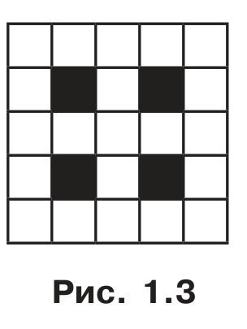

Із квадратної дошки $5\times5$ вирізали клітинки, які на рис. 1.3 позначені чорним кольором. Ту частину дошки, що залишилася, треба розрізати на прямокутники та квадрати, що складаються із цілої кількості клітинок. Яка найменша кількість квадратів може бути при такому розрізанні?

