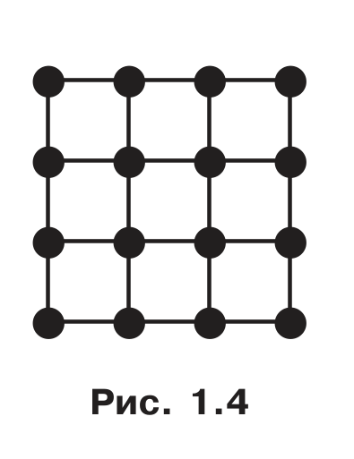

У квадраті, зображеному на рис. 1.4, у чорний колір пофарбовано $16$ точок. Яку найменшу кількість чорних точок слід перефарбувати у червоний колір, щоб не існувало жодного квадрата з усіма чорними вершинами та зі сторонами, паралельними сторонам зовнішнього квадрата?

