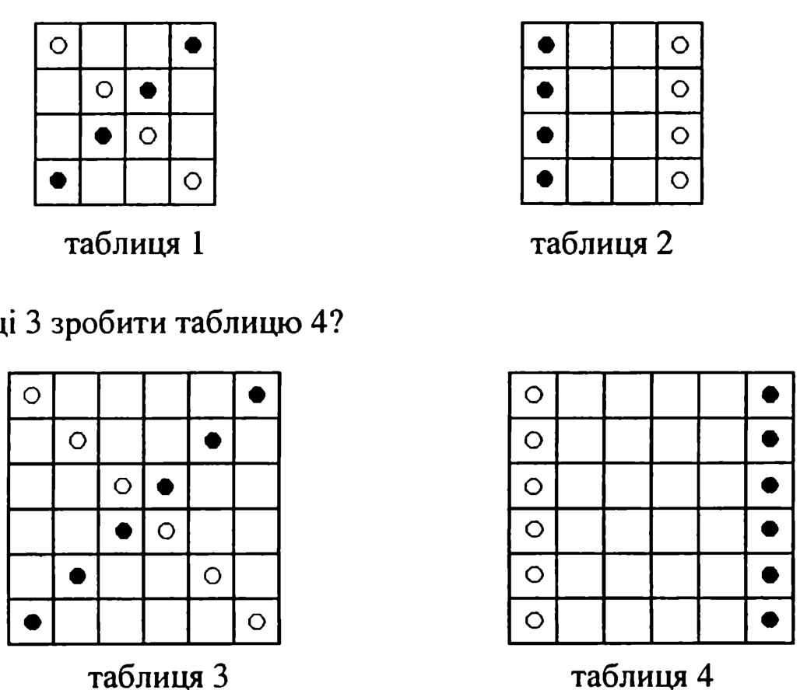

У таблиці розміщено чорні та білі шашки. За один хід дозволяється пересувати дві довільні шашки одного кольору вздовж вертикалей або вздовж горизонталей в одному або протилежному напрямах на одну клітинку. Чи можна за скінченну кількість ходів:

а) з таблиці 1 зробити таблицю 2;

б) з таблиці 3 зробити таблицю 4?

