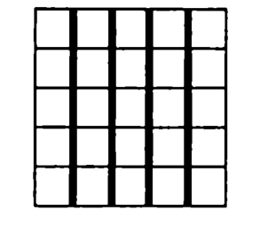

Земельну ділянку квадратної форми з площею $25$ м$^2$ потрібно розділити декількома шматками металевого дроту на п'ять "клітчастих" ділянок однакової площі. На рисунку показано, як це можна зробити, якщо використати $20$ м дроту. А чи вистачить для цієї мети $16$ м дроту?

