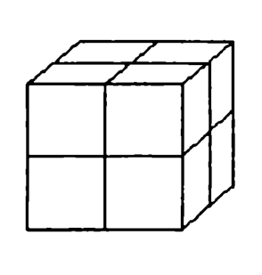

Кожна грань куба розділена на чотири квадрати (див. рис.). До кожного з цих квадратів записали число. При цьому число, що записане в будь-який з $24$ квадратів, у сумі з числами, записаними в чотири сусідні з ним квадрати, завжди дає $13$. Чи можуть усі числа бути цілими?

