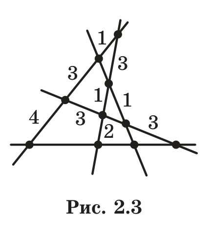

П'ять прямих попарно перетинаються, як показано на рисунку 2.3. Відомо, що довжини всіх відрізків, отриманих при перетині прямих, є натуральними числами. Чи можна отримати відрізки, довжини яких виражено такими натуральними числами (рис. 2.3)? Чи можна отримати відрізки, довжини яких показано на рисунку 2.3?

