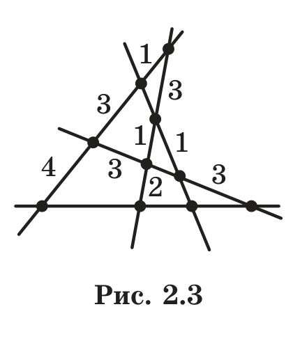

Дано квадратний тричлен $2013x^2+2012x+2011$. Двоє грають у таку гру: вони ходять по черзі. За один хід гравець може відняти від наведеного многочлена один із таких многочленів: $x^2$, $x$, $x^2-x+1$ чи $x^2+x-1$. Програє гравець, після ходу якого утворюється многочлен з цілочисловим коренем. Хто може забезпечити собі виграш - той, хто починає гру, чи його суперник?

