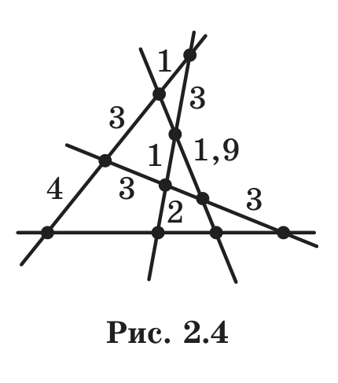

П'ять прямих попарно перетинаються, як це показано на рисунку 2.4. Чи можна отримати відрізки, довжини яких виражено такими натуральними числами (рис. 2.4)? Чи можна отримати відрізки, довжини яких показано на рисунку 2.4?

