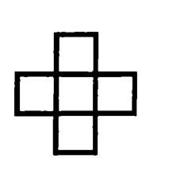

Яку найменшу кількість п'ятиклітинкових фігурок (*див. рис.*) можна випиляти по лініях сітки з клітчастої дошки розміром $8\times8$ так, щоб з решти цієї дошки не можна було випиляти по лініях сітки жодної такої ж самої фігурки?

