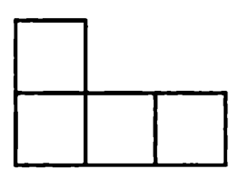

Доведіть, що для кожного натурального числа $n$ на клітчастому папері можна намалювати таку фігуру $F$, що складається із $4n$ клітинок і одночасно задовольняє такі дві умови:

1) фігуру $F$ по лініях сітки можна розбити на $n$ чотириклітинкових фігурок вигляду (такі фігурки можуть бути розташовані в довільній орієнтації);

2) існує рівно $4n - 3$ різних розбиттів (по лініях сітки) фігури $F$ на $2n$ двоклітинкових прямокутничків.

