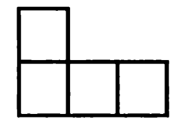

Дано натуральне число $n$. Нехай $A_n$ - кількість різних розбиттів (по лініях сітки) клітчастої дошки розміром $(6n) \times (6n)$ на $6n^2$ клітчастих прямокутників розміром $2 \times 3$ (у будь-якій орієнтації), $B_n$ - кількість різних розбиттів (по лініях сітки) клітчастої дошки розміром $(12n) \times (12n)$ на $36n^2$ чотириклітинкових фігурок вигляду (такі фігурки також можуть бути розташовані в довільній орієнтації). Доведіть, що $B_n \ge A_n \cdot 10^{6n^2}$.

