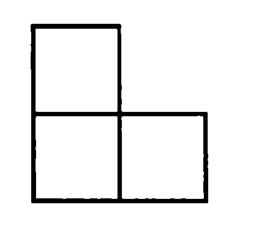

У клітчастому квадраті розміром $(2n+1) \times (2n+1)$ ($n$ - натуральне число) довільно зафарбували $2n^2 + 3n + 2$ клітинки. Чи завжди буде зафарбованою хоча б одна триклітинкова фігурка вигляду (у будь-якому розташуванні)?

