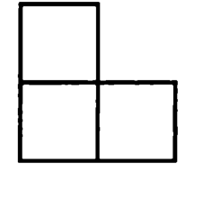

З клітинкового паперу по лініях сітки вирізали прямокутник розмірами $2^{2003}\times 2^{2005}$. Після цього з одержаного прямокутника вирізали довільно одну з клітинок. Чи завжди отриману фігуру можна по лініях сітки розрізати на триклітинкові фігурки вигляду (у довільній орієнтації)?

