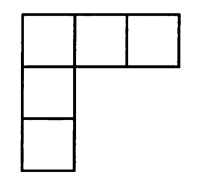

Нехай $m$ - найменша можлива кількість зображених на рисунку п'ятиклітинкових фігурок (такі фігурки можуть бути розташовані в довільній орієнтації), яку потрібно вирізати по лініях сітки з клітчастої дошки розміром $2006\times 2006$ (кожна клітинка є квадратом розміром $1\times 1$) так, щоб після цього по лініях сітки вже неможливо було вирізати жодної такої фігурки. Доведіть, що $250000<m<340000$.

