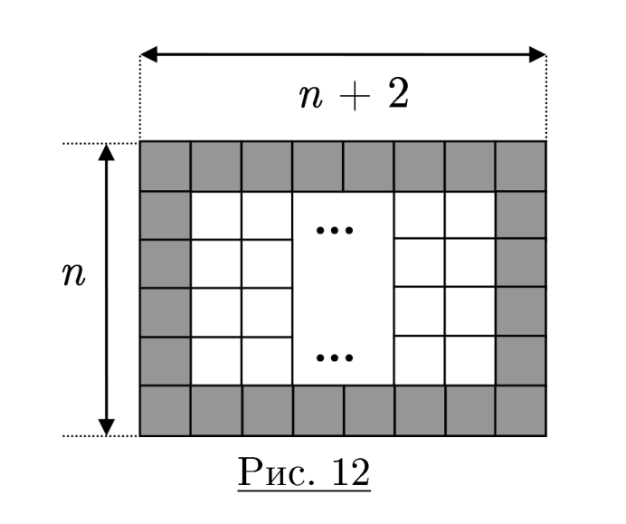

Прямокутний папір у клітинку має розмір $2009 \times 4018$. Розглядаються рамки прямокутників розмірами $n \times n$ та $n \times (n+2)$, що складаються з клітин, які мають принаймні одну спільну сторону з межею прямокутника (на рис.12 зображено приклад рамки для прямокутника розмірами $n \times (n+2)$, аналогічно виглядає рамка для прямокутника $n \times n$).

До рамок прямокутників також будемо відносити прямокутники розміром $1 \times 1$, $2 \times 2$, $1 \times 3$ та $2 \times 4$. Варя і Таня по черзі зафарбовують в межах заданого прямокутника вказані рамки. При цьому кожна нова рамка не повинна мати спільних клітин з жодною з попередніх. Починає гру Варя, переможцем вважається та дівчинка, якій вдасться зафарбувати останню рамку. Хто з гравців може забезпечити собі виграш?

