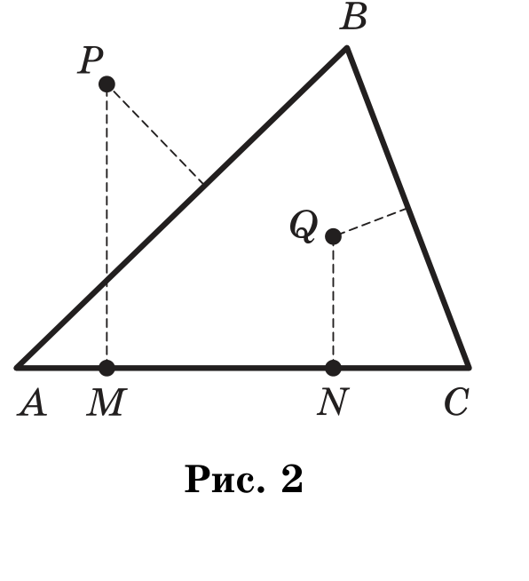

Дано гострокутний трикутник $ABC$. На серединних перпендикулярах до його сторін $AB$ і $BC$ відмітили відповідно точки $P$ і $Q$, а $M$ і $N$ - їх проекції на сторону $AC$ (рис. 2). З'ясувалося, що $2MN = AC$. Доведіть, що коло, описане навколо трикутника $PBQ$, проходить через центр кола, описаного навколо трикутника $ABC$.

