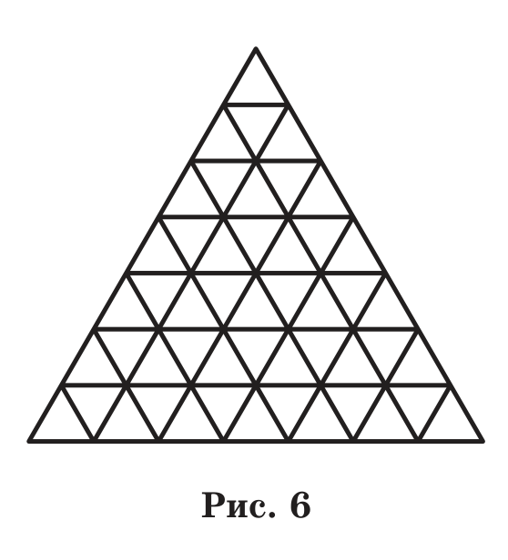

Правильний трикутник зі стороною $7$ поділено на $49$ маленьких правильних одиничних трикутничків так, як показано на рис. 6. Із нього вирізають уздовж ліній сітки паралелограми, одна сторона яких дорівнює $1$, а друга дорівнює $2$. Яку найбільшу кількість таких паралелограмів можна вирізати?

