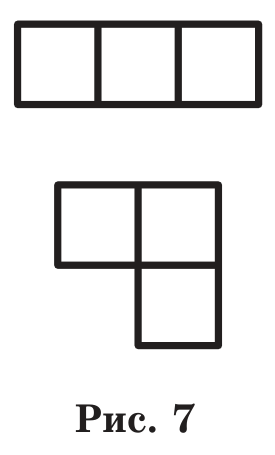

Яка найменша кількість кольорів потрібна для того, щоб зафарбувати клітчасту дошку розміром $2011 \times 2011$ таким чином, щоб кожні три клітинки на дошці, які утворюють одну з фігурок триміно (пряме триміно або кутове триміно, рис. 7) у довільній орієнтації, були пофарбовані в різний колір? Кожен одиничний квадратик фарбується повністю в один колір.

