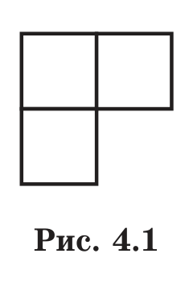

Яку найбільшу кількість кутиків із трьох клітинок (рис. 4.1) можна розмістити всередині клітчастого квадрата розміром $7 \times 7$ так, щоб вони попарно не дотикалися сторонами? (Дотикання кутами припускається.)

