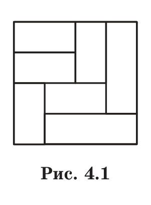
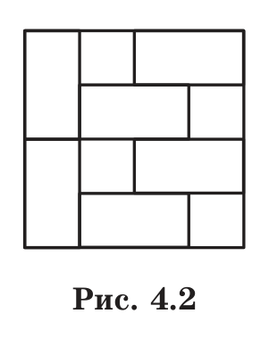

Назвемо квадрат $n\times n$, який розбито на прямокутники меншого розміру, *міцним*, якщо не існує прямої, яка розділяє квадрат на дві частини та при цьому не перетинає жодного маленького прямокутника у внутрішніх точках. Так, на рис. 4.1 зображено міцний квадрат $4\times4$, а на рис. 4.2 - квадрат, який не є міцним. Для довільного заданого натурального $m$ з'ясуйте, при яких натуральних $n$ можна розбити квадрат $n\times n$ на прямокутники $m\times1$ та $1\times m$ так, щоб цей квадрат був міцним.

