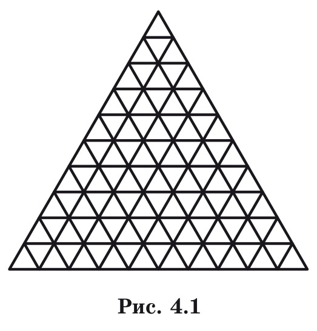

Рівносторонній трикутник зі стороною $n$ поділено на $n^2$ маленьких рівносторонніх трикутників зі стороною довжини $1$ (рис. 4.1). Із самого початку один з них, що не має спільних точок із зовнішніми сторонами великого трикутника, пофарбували в синій колір, а решту - у жовтий. За один хід можна вибрати будь-який з $n^2$ маленьких трикутників і поміняти його колір та кольори сусідніх із ним по стороні трикутників (із синього - на жовтий і навпаки). Чи можна за декілька ходів зробити всю дошку однокольоровою?

