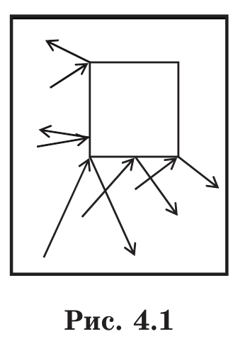

Дано квадрат $2021\times 2021$ із дзеркальною внутрішньою межею, у якому $2020$ квадратиків $1\times 1$ мають дзеркальну зовнішню межу, а всі інші квадратики мають прозорі межі. Вибирають довільний кут $\alpha\in(0^\circ, 90^\circ)$. Промінь світла проходить без зміни напрямку крізь прозору межу та відбивається за законом відбивання світла, коли потрапляє на дзеркальну межу. При цьому, якщо промінь потрапляє точно в кут дзеркального квадратика, то він відбивається так само, як від горизонтальної сторони квадратика (рис. 4.1). Доведіть, що з деякої точки нижньої сторони квадрата можна випустити промінь світла, що утворює вибраний кут $\alpha$ із цією стороною (таких променів є два) так, щоб світло дійшло до верхньої сторони квадрата.

