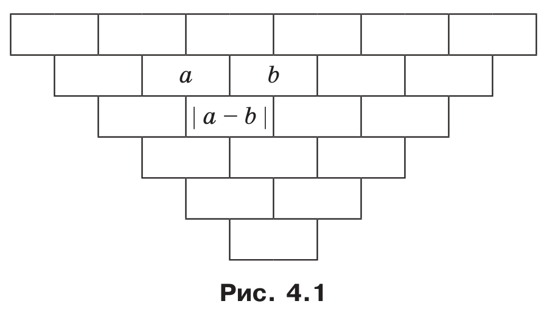

Дано таблицю, у першому рядку якої є $n$ комірок, де $n>2$, у другому рядку - $(n-1)$ комірка, у третьому - $(n-2)$ комірки, …, у $n$-му рядку - лише одна комірка. Комірки розташовані так, як це показано на рис. 4.1.

У кожну комірку верхнього рядка Петрик у довільному порядку вписує одне із чисел $1, 2, \ldots, n$ рівно один раз. Після цього в усі інші комірки, розташовані нижче, він вписує числа за таким правилом: якщо в рядку над певною коміркою розташовані дві комірки, у яких записано числа $a$ та $b$, то в цю комірку він має вписати число $|a-b|$. Яке найбільше число може бути вписане в єдину комірку нижнього рядка?

