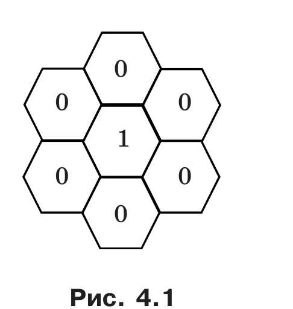

В Олексія є така сітка із $7$ шестикутних комірок (рис. 4.1). Спочатку в центральній комірці записано число $1$, в інших - число $0$. За одну операцію Олексій може вибрати довільну комірку й або додати $1$ до всіх чисел у сусідніх по стороні комірках, або відняти $1$ від усіх таких чисел (при цьому число в самій комірці не змінюється). Чи зможе Олексій зробити числа в усіх комірках рівними $0$?

